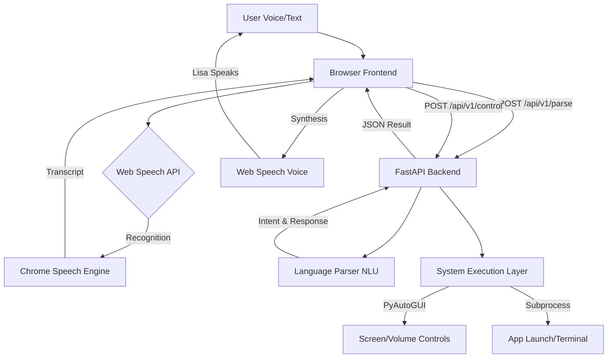
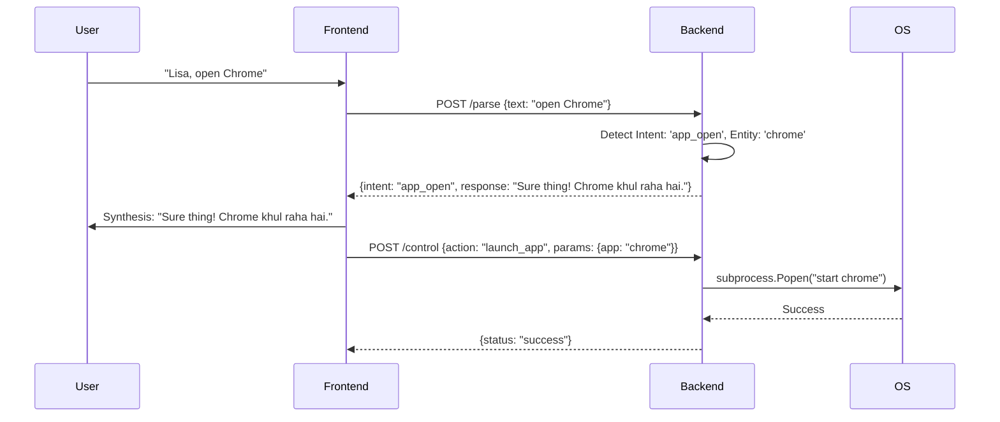

# LISA-AI-FULL-CONTROL-GOD-MODE-
THIS PROJECT  IS THE PURE IDEA OF AI TOOLS +GOOD PROMPTING
# LISA AI - God Mode v2.0

LISA AI is an advanced, voice-controlled AI assistant designed to provide "God Mode" access to your system. Featuring a stunning glassmorphism UI and a realistic 3D animated avatar, Lisa can understand commands in English, Hindi, and Hinglish to control various aspects of your computer.

## 🚀 Features

- **Voice Command Processing**: Supports English, Hindi, and Hinglish informal speech.
- **Realistic 3D Avatar**: Animated avatar with talking, blinking, and emotional states (smiling, crying, angry, etc.).
- **System Control (God Mode)**:
  - **App Management**: Open/Close common applications (Chrome, Notepad, VS Code, Discord, etc.).
  - **Volume & Brightness**: Adjust system volume and screen brightness via voice.
  - **Security**: Lock your workstation instantly.
  - **System Settings**: Access Display, Wifi, Bluetooth, and Personalization settings.
  - **Terminal Access**: Execute low-level system commands.
- **Interactive UI**: Futuristic terminal log, speech bubbles, and glassmorphism design.

## 🛠️ Tech Stack

### Frontend
- **HTML5**: Semantic structure.
- **Vanilla CSS3**: Rich aesthetics, glassmorphism, and complex animations (lip-sync, scanning line).
- **JavaScript (Vanilla)**: Handles Web Speech API (Recognition/Synthesis) and API communication.

### Backend
- **Python 3.x**: Core logic.
- **FastAPI**: High-performance API server.
- **Language Parser**: Custom NLU engine for multi-language intent detection.
- **PyAutoGUI & Subprocess**: For low-level system interaction and control.

---

## 🏗️ System Architecture

The following diagram illustrates the interaction between the user, the browser-based frontend, and the Python-powered backend.



## 🧠 Technical Deep-Dive

### 1. Command Processing Flow
Lisa uses a two-stage process to handle user requests:

1.  **Parsing Stage**: The `language_parser.py` module cleans the input (removing wake words like "Lisa") and uses a keyword-based NLU engine to identify intents. It handles informal Hinglish patterns (e.g., "khul", "chalu kar", "band kar").
2.  **Execution Stage**: Once an intent is identified, the backend maps it to a system operation in `main.py` using `pyautogui` for peripherals or `subprocess.Popen` for system-level actions.



### 2. API Orientation

The backend exposes the following endpoints:

| Endpoint | Method | Description | Payload Example |
| :--- | :--- | :--- | :--- |
| `/api/v1/status` | `GET` | Heartbeat to check if God Mode is active. | `N/A` |
| `/api/v1/parse` | `POST` | Converts speech text into a structured intent. | `{"text": "volume badhao"}` |
| `/api/v1/control" | `POST` | Executes the actual system command. | `{"action": "volume", "params": {"direction": "up"}}` |

### 3. NLU Logic (`language_parser.py`)
The parser is built to be robust against informal speech by using:
*   **Keyword Sets**: Extensive lists of synonyms for "open", "close", "delete", etc., in multiple scripts.
*   **Cleaners**: Automated removal of noise and wake words.
*   **Fallbacks**: If no specific intent is detected, the command is treated as a potential terminal instruction, allowing for advanced user flexibility.

## 📁 Project Structure

```text
maichel/
├── backend/                # Python Backend
│   ├── main.py             # FastAPI Server & Control Routes
│   ├── language_parser.py  # Multi-lang NLU Engine
│   ├── safety.py           # Safety Guardian (Integrations pending)
│   ├── logger.py           # Command Audit Logger (Integrations pending)
│   └── requirements.txt    # Python Dependencies
├── .venv/                  # Virtual Environment
├── app.js                  # Frontend Logic & Speech System
├── index.html              # Main User Interface
├── style.css               # Styling & Animations
├── install.bat             # Dependency Installation Script
└── run_michael.bat         # Launcher Script
```

## ⚙️ Installation

1. **Clone the repository** to your local machine.
2. Ensure you have **Python 3.8+** installed.
3. Run the installation script:
   ```bash
   install.bat
   ```
   *This will create a virtual environment and install all necessary dependencies.*

## 🏃 Usage

1. Start the Lisa AI system by running:
   ```bash
   run_michael.bat
   ```
2. The application will launch a local server and give you an address (typically `http://127.0.0.1:8000/app`).
3. Open the URL in your browser.
4. Click **ACTIVATE LISA AI** to enable microphone and voice features.
5. Say "Lisa" followed by your command (e.g., "Lisa, notepad kholo" or "Lisa, set brightness to 50").

## ⚠️ Safety Warning

LISA AI operates in **God Mode**, meaning it has high-level access to your system commands. Always review the commands you are issuing, especially when using terminal-based functions.

---
*Developed as part of the Michael AI Project Series.*

