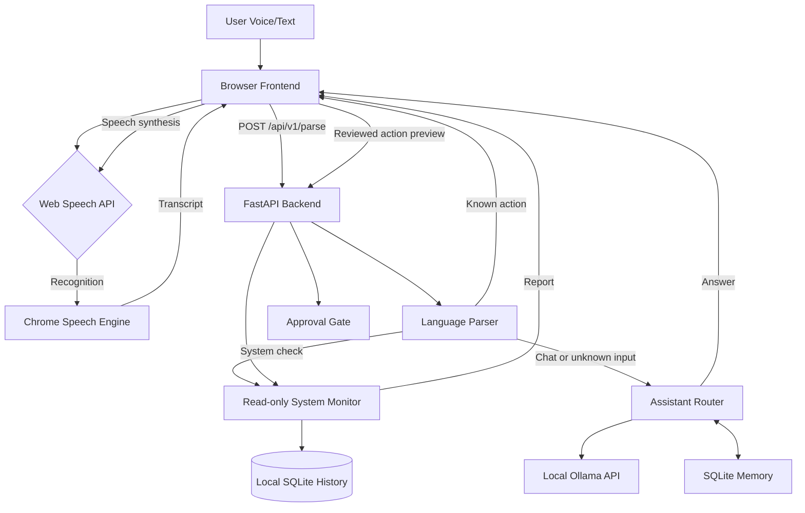
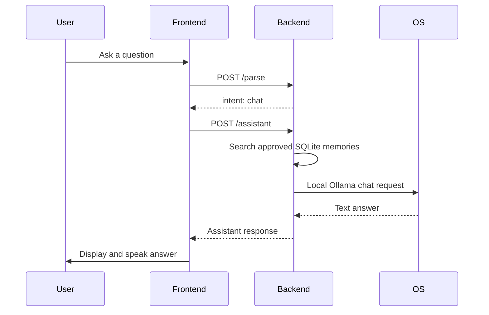

# LISA Local Assistant

LISA is a Windows-local assistant with Thai voice input/output, text chat, reviewed Skills/Tools, and user-managed SQLite memory. The interface is original and continues to include the read-only PC health dashboard.

## 🚀 Features

- **Voice and chat**: Browser speech recognition/synthesis and a text chat UI. Speech uses Thai (`th-TH`); a Thai speech voice must be available in the browser or Windows.
- **Local AI brain**: Ollama-compatible chat endpoint bound to loopback; there is no remote provider fallback.
- **Local memory**: Save, search, edit, and delete notes in SQLite after reviewing and approving each change.
- **Skills**: `/skills`, `/remember <note>`, `/recall <keyword>`, and Thai equivalents; memory writes require explicit approval.
- **PC health dashboard**: Read CPU, GPU name, RAM, system-drive space, and Windows details; show local threshold-based findings and a health score.
- **Daily history**: While the backend is running, one snapshot is saved per day to a local SQLite database; a user-triggered scan can refresh it. The dashboard can chart the last 30 days.
- **Explicit system controls**: Opening or closing apps in the reviewed allowlist requires a fresh preview and per-action approval. Direct control, arbitrary terminal execution, and unrestricted file operations are disabled.
- **Safety boundary**: Unknown input is sent to the configured local model, never treated as a terminal command. Model output cannot execute local actions.
- **Session context**: Recent turns are kept in browser memory only and cleared on page reload; transcripts are not saved.
- **Interactive UI**: Custom animated robot avatar, speech bubbles, and glassmorphism design.
- **Local diagnostics**: Hardware reports and history stay on this computer; LISA does not automatically send them to the chat provider.

## 🛠️ Tech Stack

### Frontend
- **HTML5**: Semantic structure.
- **Vanilla CSS3**: Rich aesthetics, glassmorphism, and complex animations (lip-sync, scanning line).
- **JavaScript (Vanilla)**: Handles browser speech recognition/synthesis and API communication.

### Backend
- **Python 3.x**: Core logic.
- **FastAPI**: High-performance API server.
- **Language Parser and Router**: Routes known commands to existing control actions and other input to the AI brain.
- **AI and memory**: Standard-library HTTP adapters plus an Obsidian-compatible Markdown vault.
- **SQLite & Subprocess**: Local memory and narrow, approved application actions.

---

## 🏗️ System Architecture

The following diagram illustrates the interaction between the user, the browser-based frontend, and the Python-powered backend.



## 🧠 Technical Deep-Dive

### 1. Command Processing Flow
LISA separates conversation from computer controls:

1. **Task router**: `language_parser.py` identifies supported local controls; unknown and conversational input is routed to `/api/v1/assistant`.
2. **Brain**: `assistant_core.py` sends chat requests only to the configured loopback Ollama endpoint. There is no cloud fallback, and model output cannot invoke local tools.
3. **Memory and skills**: SQLite memory is user-managed; saves, edits, and deletes go through the approval gate. Use `/skills` to inspect the reviewed tools.
4. **Control**: App actions use `/api/v1/actions/preview`, `/approve`, and `/execute`. Direct `/api/v1/control` requests are disabled.



### 2. API Orientation

The backend exposes the following endpoints:

| Endpoint | Method | Description | Payload Example |
| :--- | :--- | :--- | :--- |
| `/api/v1/status` | `GET` | Check whether the local assistant backend is online. | `N/A` |
| `/api/v1/parse` | `POST` | Converts speech/text into a known intent or `chat`. | `{"text": "volume up"}` |
| `/api/v1/assistant` | `POST` | Chat with the configured local Ollama model. | `{"message": "Hello"}` |
| `/api/v1/skills` | `GET` | List reviewed tools and declared permissions. | `N/A` |
| `/api/v1/memory` | `GET` | Review local memories. | `N/A` |
| `/api/v1/memory/search` | `POST` | Search local memories. | `{"query": "language"}` |
| `/api/v1/actions/preview` | `POST` | Preview a reviewed mutation; does not execute it. | `{"action": "memory_create", "params": {"text": "..."}}` |
| `/api/v1/actions/approve` | `POST` | Approve one unexpired preview. | `{"preview_id": "..."}` |
| `/api/v1/actions/execute` | `POST` | Execute one previously approved preview. | `{"preview_id": "..."}` |
| `/api/v1/system/report` | `POST` | Collect a read-only system report and save today's local snapshot. | `N/A` |
| `/api/v1/system/history?days=30` | `GET` | Read saved daily health reports (1–365 days). | `N/A` |
| `/api/v1/control` | `POST` | Disabled; mutations must use the approval workflow. | `N/A` |

### 3. NLU Logic (`language_parser.py`)
The parser is built to be robust against informal speech by using:
*   **Keyword Sets**: Extensive lists of synonyms for "open", "close", "delete", etc., in multiple scripts.
*   **Cleaners**: Automated removal of noise and wake words.
*   **Safe fallback**: If no known intent is detected, input is returned as `chat`; it is never converted into a shell command.

## 📁 Project Structure

```text
maichel/
├── backend/                # Python Backend
│   ├── main.py             # FastAPI Server & Control Routes
│   ├── assistant_core.py   # Local Ollama adapter and SQLite memory
│   ├── language_parser.py  # Multi-lang NLU Engine
│   ├── system_monitor.py   # Read-only hardware checks, rule-based findings, and daily history
│   ├── safety.py           # Safety Guardian (Integrations pending)
│   ├── logger.py           # Command Audit Logger (Integrations pending)
│   ├── test_assistant_core.py
│   ├── test_action_approval.py
│   ├── test_language_parser.py
│   ├── test_system_monitor.py
│   └── requirements.txt    # Python Dependencies
├── .venv/                  # Virtual Environment
├── app.js                  # Frontend Logic & Speech System
├── index.html              # Main User Interface
├── style.css               # Styling & Animations
├── install.bat             # Dependency installation script
└── run_michael.bat         # Launcher Script
```

## ⚙️ Installation

1. Install Ollama and download a local model (example: `ollama pull qwen3`).
2. Set the local endpoint and model in PowerShell, then launch LISA:
   ```powershell
   $env:LISA_OLLAMA_BASE_URL = "http://127.0.0.1:11434"
   $env:LISA_AI_MODEL = "qwen3"
   .\run_michael.bat
   ```
3. If dependencies are missing, run `install.bat` from the `maichel` folder.

## 🏃 Usage

1. Start Ollama and set `LISA_OLLAMA_BASE_URL` and `LISA_AI_MODEL` as shown above.
2. Run `run_michael.bat`; open `http://127.0.0.1:8000/app`.
3. Click **เริ่มใช้งาน LISA** to enable voice. Text chat remains available if speech recognition or a Thai voice is unavailable.
4. Use `/skills`, `/remember <note>`, `/recall <keyword>`, or the UI's memory manager. LISA asks for approval before saving, editing, or deleting a memory.

While the backend is running, LISA collects a read-only snapshot once per day and stores it at `%USERPROFILE%\.michael\system_monitor.sqlite3`. Select **ตรวจเครื่องและบันทึกผล** or say **“ลิซ่า เช็คสเปกคอม”** to refresh today's snapshot. The score is a simple local threshold check, not an AI diagnosis; it does not inspect temperatures, driver health, running processes, or predict game FPS.

Run the focused backend tests from the `backend` folder with:
```powershell
python -m unittest test_assistant_core.py test_action_approval.py test_language_parser.py test_system_monitor.py
```

## USB Device Diagnostic

For the USB migration warning involving `VID_0E6A&PID_02C0` and `VID_1D57&PID_FA60`, run `mouse_usb_diagnostic.ps1` from an elevated PowerShell window:

```powershell
powershell.exe -NoProfile -ExecutionPolicy Bypass -File .\mouse_usb_diagnostic.ps1
```

The script reports the two event instances and currently connected matching devices, then asks Windows to rescan for devices. It does not disable devices, uninstall drivers, or remove device records. Use `-NoScan` to run a read-only check.

If the matching mouse is detected but not responding, add `-RestartMouse` to request a brief restart of that mouse interface. The script asks for confirmation and requires an elevated PowerShell window; keep the keyboard available while the mouse reconnects.

To let a wake-capable mouse wake the computer from Sleep, run the script with `-EnableMouseWake`. It checks Windows' supported-device list, asks before changing the setting, and verifies the result. This does not repair mouse movement or clicks.

## ⚠️ Safety

The API listens on loopback only. LISA does not run shell commands or unrestricted file operations. A listed application action or memory change is previewed, requires explicit approval, expires after one minute, and can be executed only once. The configured local model is never silently replaced with a remote service.

---
*Developed as part of the Michael AI Project Series.*
